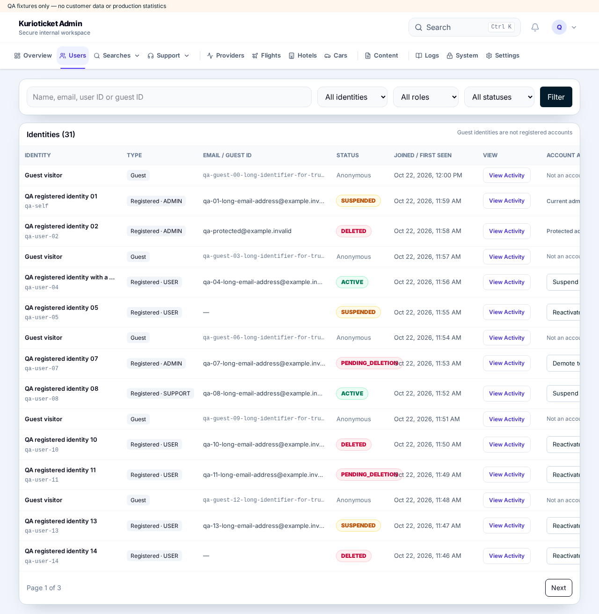
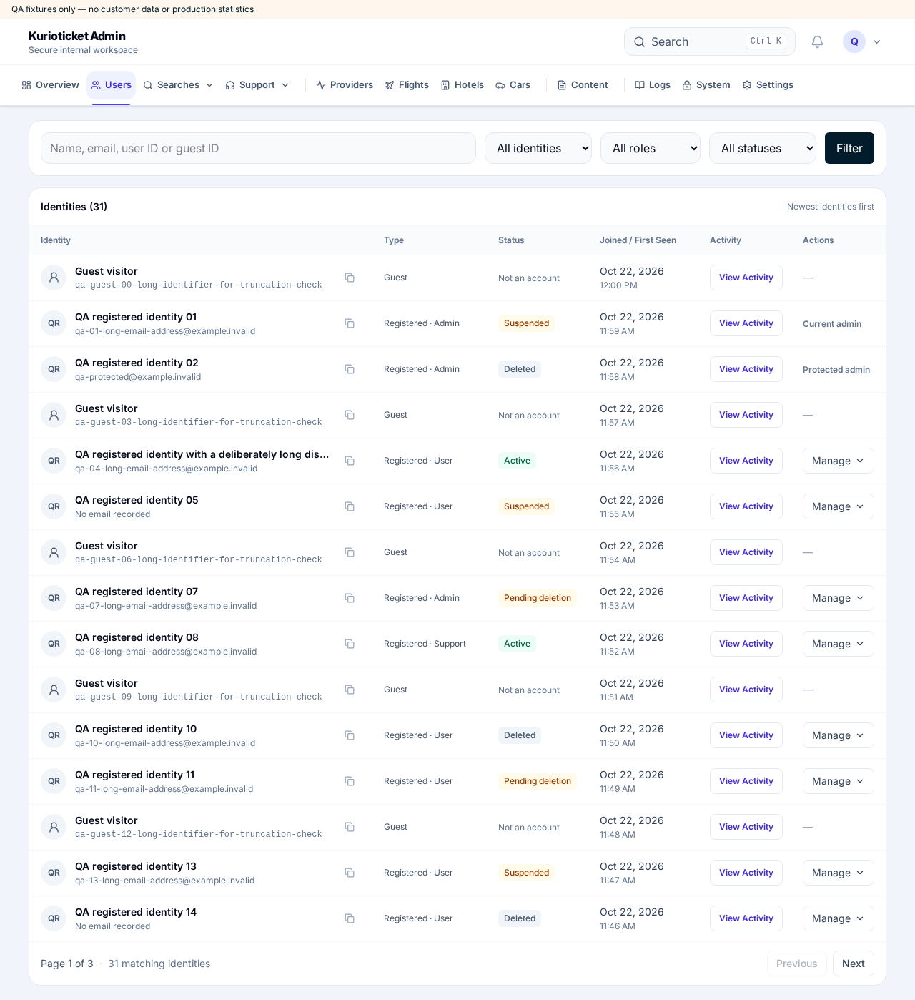

# Admin identity directory QA

Starting `dev` commit: `acc6378e4668d506b2c2045289c890bb544d07e1`.
Feature branch: `codex/refine-admin-identity-directory`. Rebased onto `47eccd8a84f91a2384e973339536846e68e480b4` to retain merged PR #6413 and its journey/analytics improvements. The `work` branch was not modified.

## Before and after

The screenshots show the actual page and components in an isolated local app with **labelled QA fixtures**, not live customers or production statistics. No fixture authentication or data adapters are imported by the production app.

| Before — 1280px | After — 1280px |
| --- | --- |
|  |  |

[Mobile at 390px](screenshots/after-390.png) · [Expanded account menu](screenshots/after-menu-1280.png)

## Repeat the browser checks

After `npm ci` and `npx playwright install chromium`:

```sh
ADMIN_IDENTITY_QA_WORK=/workspace/work/admin-directory-qa \
  node qa/admin-identity-directory/run.mjs
```

The runner creates a disposable Next.js fixture app in that scratch directory, imports the real Users page, table, actions, activity panel and unchanged Admin shell, and runs Playwright. It creates an isolated before version from the recorded starting commit. It never starts an authenticated production server or connects to a real database. All mutation requests are intercepted locally. Override `ADMIN_IDENTITY_QA_BASE`, `ADMIN_IDENTITY_QA_PORT`, or `ADMIN_IDENTITY_QA_OUTPUT` when needed. Without a scratch override, it uses `work/` below the checkout; keep generated files out of commits.

Checks cover:

- Desktop 1280, 1366, 1440, and 1920px: all six columns fit with no table or document horizontal overflow.
- Tablet 768px and mobile 390/320px: horizontal overflow stays inside the table.
- Full user/guest ID clipboard copying; long names/emails/IDs; missing email.
- Keyboard arrows, Home/End, Escape, Tab, focus restoration after menu dismissal/resize, and a touch menu inside the mobile viewport.
- Guest/self/protected-admin restrictions; administrator role-only actions.
- Suspend and soft-delete confirmation cancellation and request payloads; reactivation; server/transport errors and retry availability.
- Permanent deletion email and ID confirmation, disabled invalid submissions, server rejection, modal dismissal and restored focus.
- Name/email/user ID/guest ID searches; identity/role/status filters.
- Mixed 15-row pagination, stable newest-first order, unique identities, retained filters, and empty states.
- Registered and guest activity drawers and truthful empty timelines.

## Verification

- Production `npm run build`: passed.
- TypeScript after `next typegen`: passed.
- Lint on all changed source/test/QA files: passed. Full repository `npm run lint` (also reproduced on the starting commit): 8 existing `react-hooks/immutability` errors in `src/components/search/StandaloneFlightSearchForm.tsx` and 6 existing unused-variable warnings in `src/services/adminOperationalReadCore.ts`; these files are unchanged from the starting commit.
- Focused component/directory/pagination/journey tests: 18 passed. After rebasing, these and the newly merged request-identity/journey/Car-search tests: 43 passed.
- Full `npm test`: **4,320 passed, 35 failed** (4,355 total).
- All 35 failures reproduced on the starting commit using the same installed dependencies; the 22 affected baseline files yielded 175 passed and the identical 35 failed tests. There are no newly failing test names.
- Reproducible browser suite after rebasing: all 20 scenarios passed, with no browser errors.
- Independent code review found no security/correctness blockers. Its focus-restoration finding was fixed and verified interactively.

The full suite's existing failures are listed below so a green focused run is not mistaken for a green repository suite.

<details>
<summary>35 pre-existing failing tests</summary>

- CarCardSkeleton mirrors the compact standalone desktop price rail
- Cars count row preserves card separation after removing the tracking toggle
- Cars offer alert keeps the functional switch and accessible translated name
- Cars rate alerts display Track car prices with an offer-specific accessible name
- Cars results heading keeps the compact mobile gutters and card gap without a tracking bar
- Compare deals selection stays mounted and never uses the full-page Cars skeleton
- KAYAK car cards and loading canvases stay inside the same standalone desktop surface contract
- desktop Cars Results uses the same Inter foundation as mobile web
- desktop Cars pricing and price tracking keep price emphasis without over-weighting metadata
- desktop Cars results body is compact, centered, and keeps shared surfaces aligned
- desktop Flight Results keeps page-owned navbar geometry while search waits for readiness
- desktop Flight Results moves price tracking into the sidebar without replacing mobile contracts
- desktop Flight Results puts the Hotels-style summary directly above result cards
- desktop Flight filters keep long range values visibly separated
- desktop Multi-city marks the sticky editor open before observer callbacks can collapse it
- desktop and mobile car rates share an inline tracking control inside rate details
- desktop fare geometry preserves seven dates and complete price accessibility
- desktop filter groups use sentence-case headings and accessible rows
- desktop typography polish leaves the established mobile Cars hierarchy intact
- facet rows reserve flexible copy space and a fixed count column
- mobile homepage keeps its existing dedicated Flight form
- mobile result rhythm no longer reserves space for the removed summary card
- mobile typography remains intact while desktop is refined
- mobile web Hotel results navbar uses an edit icon for the search summary
- native Cars price-alert success path creates automatic tracking and can pause or reactivate
- provider APIs, retest API, and unrelated admin pages are not edited by provider page consolidation
- remaining supplier-information surfaces preserve sanitized facts without truncation
- results navbar can render filters as part of the mobile header body
- route field is one grouped control with a circular swap and interrupted divider
- source-contract: sticky editor lifecycle keeps scroll locking independent from nested controls
- src/app/api/admin/support/ticket-route.test.ts
- standalone desktop T divider spans both remaining columns after vehicle and amenities
- standalone desktop result cards use a polished identity, details, and price hierarchy
- standalone mobile Cars preserves filter-to-count spacing while adding a small first-card gap
- standalone result commerce is provider-ready without fabricating booking URLs

</details>

## Required final review

The approved reference image was not attached in this conversation; implementation follows the supplied written visual constraints and existing palette. Review the final UI before merging. Authenticated staging verification with real permitted identities, recorded journeys, and audited mutations remains necessary because no staging session or database was supplied. Fixture checks verify UI interaction and payloads, not live persistence or audit writes. Required GitHub checks must pass; this PR must not be merged automatically.
