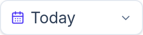
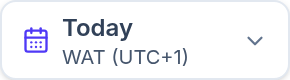

# Admin reporting time zones

## Date filter

The screenshots show the Overview date filter in Chromium with a Lagos browser setting and an isolated PostgreSQL fixture.

| Before on `dev` | After with Lagos reporting |
| --- | --- |
|  |  |

## Reporting coverage

- `adminLocalTime.ts`, `adminReportingRanges.ts`, and `adminOverviewRange.ts` calculate local calendar boundaries and convert them to UTC query instants. Elapsed rolling periods retain their durations.
- `adminViewerTimeZone.server.ts`, `reportingTimeZoneActions.ts`, and `AdminSearchTimeZoneSync.tsx` share an authenticated, per-account browser preference across Admin.
- The Overview, Search Activity, Journey History, Visitor and User Activity, Provider Handoffs, Provider and Platform Health, Audit Logs, Settings History, Email Delivery, and date-filtered operations queues and trip reports use the reporting preference.
- Existing absolute investigation links preserve their UTC instants. Storage, search execution, bot attribution, and provider behavior retain their existing contracts.

## November 25 verification

The same fixture held 19 searches in the first hour of November 25 in Lagos and 21 more after midnight UTC. The signed-in Overview counted 21 with the original UTC filter and 40 using the Lagos filter. The fixture represents the reporting boundary. Production historical records were unavailable for this comparison.
