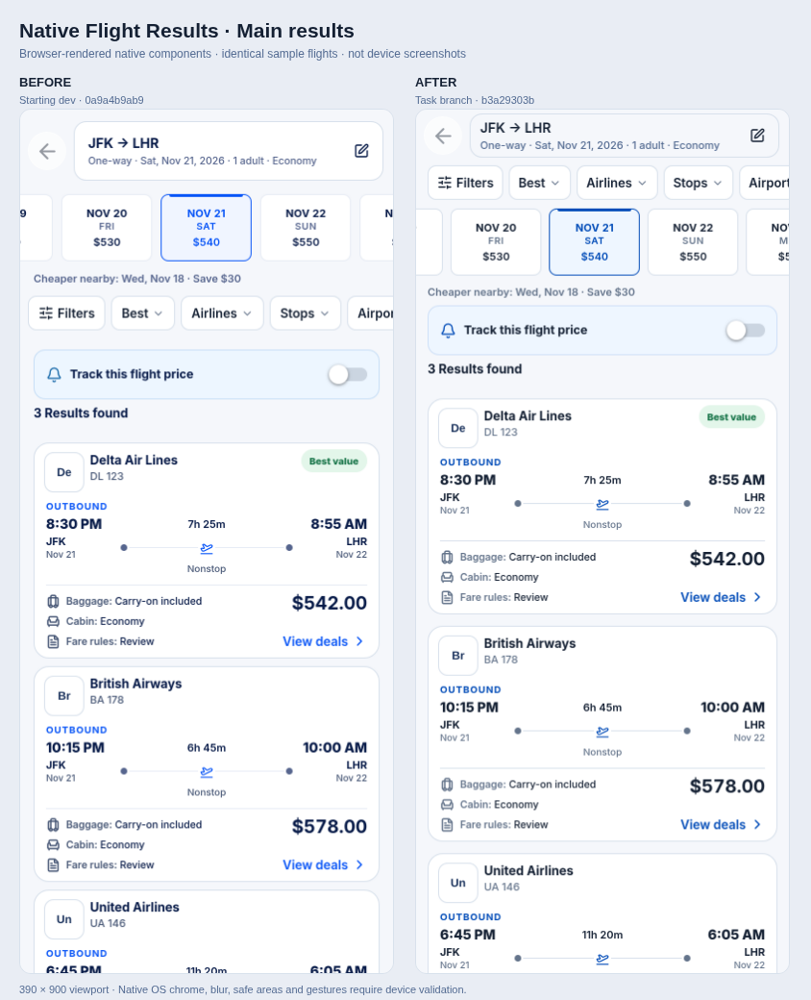

# Native Flight Results presentation parity

Starting dev: `0a9a4b9ab9c32de6e853dddc7cbf9d0867775910`  
Branch: `fix/native-flight-results-parity`

## Before and after images

Preview assets branch: `docs/native-flight-results-visual-comparisons`, based on current dev `bc4332add366ea8c8ecf7c0385bb22664cae4c01` after PR #6359 merged. The implementation baseline and validation below remain the historical record for the original change.

Browser-rendered previews of the native components using identical fixture data. **These are not native device screenshots.** The capture harness, platform adaptations and reproduction steps are documented [here](preview/README.md).

| State | Comparison | Before | After |
| --- | --- | --- | --- |
| Results | [Side by side](images/results-comparison.png) | [Before](images/results-before.png) | [After](images/results-after.png) |
| Selected filters | [Side by side](images/selected-filters-comparison.png) | [Before](images/selected-filters-before.png) | [After](images/selected-filters-after.png) |
| Airlines quick sheet | [Side by side](images/airlines-sheet-comparison.png) | [Before](images/airlines-sheet-before.png) | [After](images/airlines-sheet-after.png) |
| Full filters | [Side by side](images/full-filters-comparison.png) | [Before](images/full-filters-before.png) | [After](images/full-filters-after.png) |
| Sort sheet | [Side by side](images/sort-sheet-comparison.png) | [Before](images/sort-sheet-before.png) | [After](images/sort-sheet-after.png) |

## Changes

- Place the single sticky filter rail before naturally scrolling dates; retain dates for empty/error/filtered states.
- Compact the editable native summary to 44px; preserve Back, edit behavior and native safe areas.
- Use 12px content gutters, 80px date rail, 8px date gaps, 70px date cards and 12px card spacing.
- Give selected airline/stops/airport groups navy/white styling and independent localized clear actions with separate 44px targets. Preserve Android non-responder tap-versus-drag observation and iOS Pressable activation.
- Compact quick/full filter density, keep all categories and filter behavior, show matching counts in quick facets, retain full-filter price insights.
- Scope approved light colors through a Flight Results provider. Shared components return their original palette outside this provider and in dark mode. Quick-sheet density/backdrop changes require an explicit Flight opt-in.
- Correct web QA to use continuous results, measure actual virtual rows and the whole virtual list extent, assert no pagination, and assert existing 12px card gutters. Wait for Edit Search dismissal/scroll restoration before comparing the unchanged exact scroll position.

No production web UI, native Flight Details, global palette, Hotel/Car presentation or backend behavior changes. No Back-to-top was added. The Hotel-named test has only its cross-component Flight capsule assertion updated; Hotel assertions remain intact. The original `work` checkout stays on its original branch/HEAD and is clean.

## TDD evidence

`cfeeb7b49` commits the new contracts before implementation. On starting dev:

- Native contracts: **0 passed / 11 failed**, for the missing scoped palette, layout/density, quick-group clear and count behavior.
- Web QA contract: **0 passed / 1 failed**, because the obsolete paginated selector remained.
- Added a terminal-state date regression during review; it failed before preserving dates in the state footer.

## Validation

- `cd apps/mobile && npm test -- --test-concurrency=2`: **2,254 passed / 0 failed** (baseline: 2,242 passed).
- Focused quick-controls/layout and unchanged Hotel contracts after final review: **28 passed / 0 failed**.
- `cd apps/mobile && npm run typecheck`: passed.
- Root `npx tsc --noEmit`: passed with clean lockfile dependencies and generated Prisma client.
- Root ESLint on the two changed web QA/test files: passed.
- Native has no lint script and root ESLint excludes `apps/mobile`. A focused TypeScript unused-code/hooks lint run reports **the same 14 existing unused-code errors** in `ApprovedResultsScreen.tsx` on starting dev and this branch; no new errors or hooks violations.
- Full root suite: **4,112 passed / 27 failed**. Untouched starting dev with the same dependencies: **4,111 passed / the same 27 failed**. Failure-name sets match exactly. Existing failures span stale desktop/mobile source contracts in Cars, Flight headers/filters, Hotel headers, supplier-information and homepage tests; no tests disabled or deleted.
- Focused continuous QA/Flight viewport tests: **5 passed / 0 failed**.
- Chromium touch/mobile emulation, the actual `qa/mobile-web/tests/flights.spec.ts`, deterministic existing 12-flight fixture: **5 passed / 0 failed**. Widths: 320, 360, 390, 412px. Validates real virtual rows, no document overflow, both horizontal rails, geometry/footer spacing and Edit Search exact scroll restoration. A scratch wrapper only routes `/api/flights/search` to the existing fixture proxy; all assertions are from the repository spec. Direct Next origin was used to allow development HMR; proxying page assets stalled hydration.
- Expo local Hermes exports: **iOS and Android passed** using preview/local mode and a loopback public API URL; no deployment or EAS build.
- `git diff --check`: passed.

Native visual/device QA and real iOS Safari remain outstanding: this environment has no Android device/emulator, iOS simulator or a configured real-Safari session. Native bundles and automated contracts do not substitute for those checks. No native screenshots are claimed.

## Existing web test failures (same on starting dev)

- results navbar can render filters as part of the mobile header body
- standalone result commerce is provider-ready without fabricating booking URLs
- standalone desktop T divider spans both remaining columns after vehicle and amenities
- mobile result rhythm no longer reserves space for the removed summary card
- Compare deals selection stays mounted and never uses the full-page Cars skeleton
- Cars results heading aligns to the inner card gutters and sits close to the first card on mobile
- Cars heading has balanced vertical clearance with the tighter mobile card gap
- standalone mobile Cars redistributes space from the card gap to the filter separation
- desktop Cars results body is compact, centered, and keeps shared surfaces aligned
- KAYAK car cards and loading canvases stay inside the same standalone desktop surface contract
- desktop Cars Results uses the same Inter foundation as mobile web
- standalone desktop result cards use a polished identity, details, and price hierarchy
- desktop typography polish leaves the established mobile Cars hierarchy intact
- source-contract: sticky editor lifecycle keeps scroll locking independent from nested controls
- desktop Flight Results moves price tracking into the sidebar without replacing mobile contracts
- desktop Flight filters keep long range values visibly separated
- facet rows reserve flexible copy space and a fixed count column
- desktop filter groups use sentence-case headings and accessible rows
- desktop Multi-city marks the sticky editor open before observer callbacks can collapse it
- route field is one grouped control with a circular swap and interrupted divider
- desktop Flight Results keeps page-owned navbar geometry while search waits for readiness
- desktop Flight Results puts the Hotels-style summary directly above result cards
- mobile web Hotel results navbar uses an edit icon for the search summary
- desktop fare geometry preserves seven dates and complete price accessibility
- remaining supplier-information surfaces preserve sanitized facts without truncation
- mobile homepage keeps its existing dedicated Flight form
- CarCardSkeleton mirrors the compact standalone desktop price rail

## Changed files

- `AGENTS.md`
- `apps/mobile/src/features/flow/flowStyles.ts`
- `apps/mobile/src/features/flow/stableVerticalScrolling.test.ts`
- `apps/mobile/src/features/search/ApprovedResultsScreen.tsx`
- `apps/mobile/src/features/search/FlightFilterSheet.test.ts`
- `apps/mobile/src/features/search/FlightFilterSheet.tsx`
- `apps/mobile/src/features/search/FlightRangeSlider.tsx`
- `apps/mobile/src/features/search/FlightResultsPresentationContext.tsx`
- `apps/mobile/src/features/search/FlightResultsQuickControls.tsx`
- `apps/mobile/src/features/search/FlightResultsSheetShell.tsx`
- `apps/mobile/src/features/search/FlightResultsState.tsx`
- `apps/mobile/src/features/search/FlightSortSheet.tsx`
- `apps/mobile/src/features/search/HotelPriceAlert.tsx`
- `apps/mobile/src/features/search/SearchUi.tsx`
- `apps/mobile/src/features/search/airlineLogoProduction.test.ts`
- `apps/mobile/src/features/search/approvedResultsHierarchy.test.ts`
- `apps/mobile/src/features/search/dateStripElevation.test.ts`
- `apps/mobile/src/features/search/dateStripNaturalScroll.test.ts`
- `apps/mobile/src/features/search/flightCardRefinement.test.ts`
- `apps/mobile/src/features/search/flightFilters.ts`
- `apps/mobile/src/features/search/flightLoadingExperience.test.ts`
- `apps/mobile/src/features/search/flightResultsHeader.test.ts`
- `apps/mobile/src/features/search/flightResultsPresentation.test.ts`
- `apps/mobile/src/features/search/flightResultsPresentation.ts`
- `apps/mobile/src/features/search/flightResultsQuickControls.test.ts`
- `apps/mobile/src/features/search/flightResultsSheetShell.test.ts`
- `apps/mobile/src/features/search/flightSearchReliability.test.ts`
- `apps/mobile/src/features/search/flightSortExperience.test.ts`
- `apps/mobile/src/features/search/hotelResultsQuickControls.test.ts`
- `apps/mobile/src/features/search/nativeFlightResultsParity.test.ts`
- `apps/mobile/src/features/search/resultsScrollLayout.test.ts`
- `apps/mobile/src/theme/darkModeConsistency.test.ts`
- `qa/mobile-web/tests/flights.spec.ts`
- `qa/native-flight-results-parity/README.md`
- `src/components/results/mobileFlightContinuousQa.test.ts`
